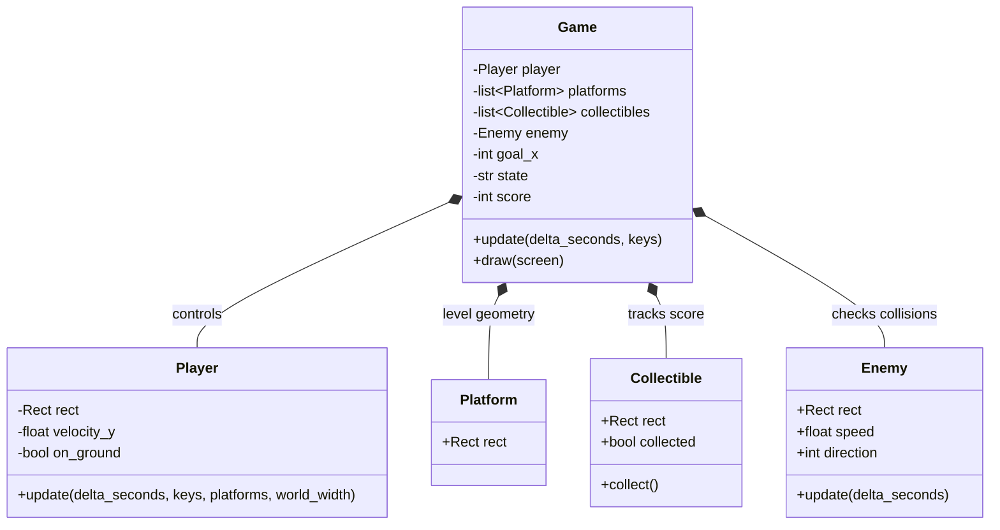

<div align="right">
 


</div>

# cs-530-ai-principals-and-applications
Work from AI Principals and Applications

## About

## Motivation
To show the work done in CS 510 Operating Systems Principles from SNHU.

## Getting Started
Setup is done via `git clone url`.

Then the dependecies to add are .

## Installation

### Tools
Installation best via a system level package manager or ephemeral build environment.
Transitvie dependecies such as language are shown via tree level.

- git
- python 3.14

## Reflection


## Design Overview

Testing is done using main.yml as main entrypoint to run the diffrent project tests.

### Module 5

<details>
<summary>Click to see</summary>

#### UML Class Diagram



### Code Examples

#### src

<details>
<summary>Click to see</summary>

```python

```
</details>

#### Unit Test

<details>
<summary>Click to see</summary>

```python

```

</details>

#### Integration Test

<details>
<summary>Click to see</summary>

```python

```

</details>

</details>

### Screenshots of Application

<div align="center">
  
</div>

<div align="center">
  
</div>
