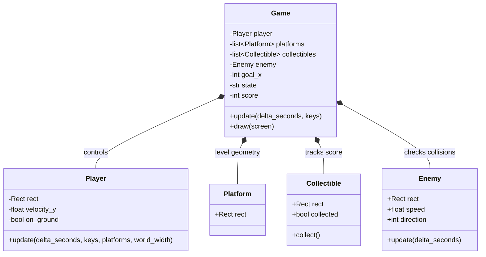
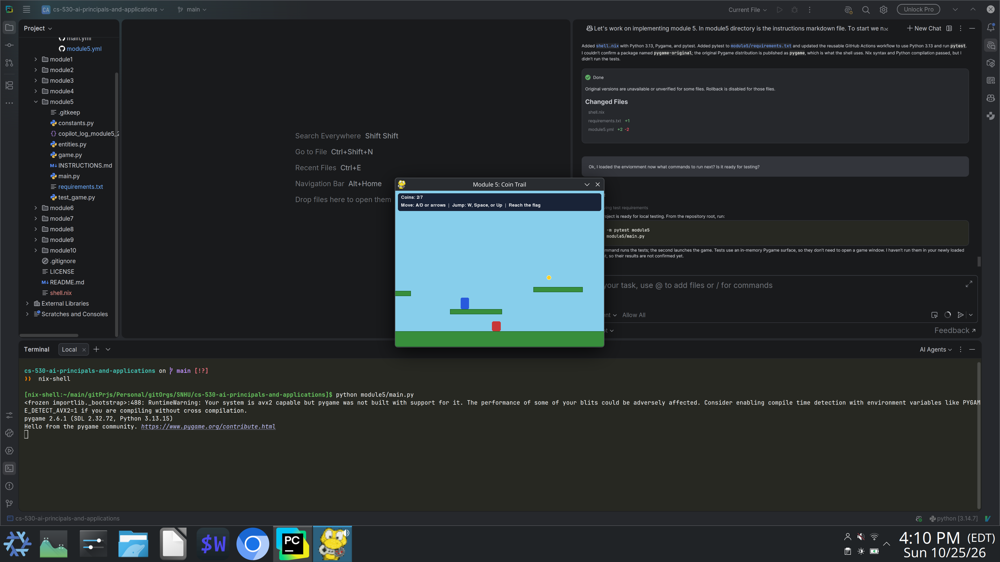
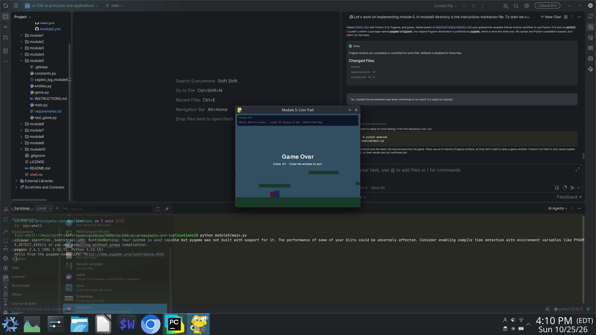
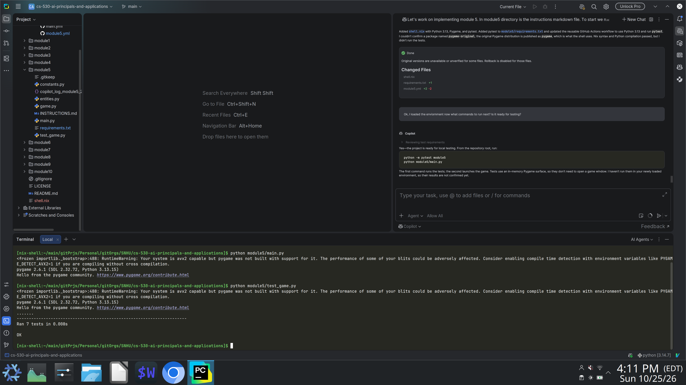
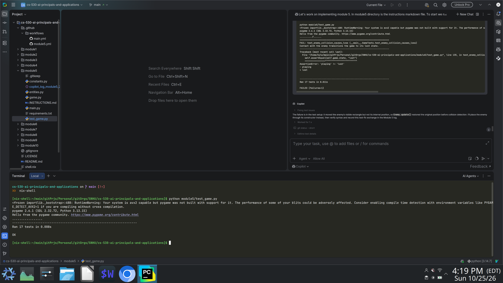

<div align="right">
 


</div>

# cs-530-ai-principals-and-applications
Work from AI Principals and Applications

## About

## Motivation
To show the work done in CS 510 Operating Systems Principles from SNHU.

## Getting Started
Setup is done via `git clone url`.

Then the dependecies to add are .

## Installation

### Tools
Installation best via a system level package manager or ephemeral build environment.
Transitvie dependecies such as language are shown via tree level.

- git
- python 3.14

## Reflection


## Design Overview

Testing is done using main.yml as main entrypoint to run the diffrent project tests.

### Module 5

<details>
<summary>Click to see</summary>

#### UML Class Diagram



#### Source Code

- [Game entry point](module5/main.py)
- [Game state and rendering](module5/game.py)
- [Player, platform, collectible, and enemy entities](module5/entities.py)
- [Game constants](module5/constants.py)
- [Python dependencies](module5/requirements.txt)

Run the game from the repository root:

```bash
python module5/main.py
```

#### Testing

Run the unit tests from the repository root:

```bash
python -m pytest module5
```

The tests in [test_game.py](module5/test_game.py) cover player jumping, platform
landing, world boundaries, entity validation, coin scoring, enemy collision,
falling, win/loss states, and rendering to an in-memory Pygame surface. GitHub
Actions runs this same test command on pushes to `main` and on manual dispatch.

#### Screenshots

<div align="center">
  
  <p>Gameplay</p>
</div>

<div align="center">
  
  <p>Game over screen</p>
</div>

<div align="center">
  
  <p>Initial test run</p>
</div>

<div align="center">
  
  <p>Updated test run</p>
</div>
