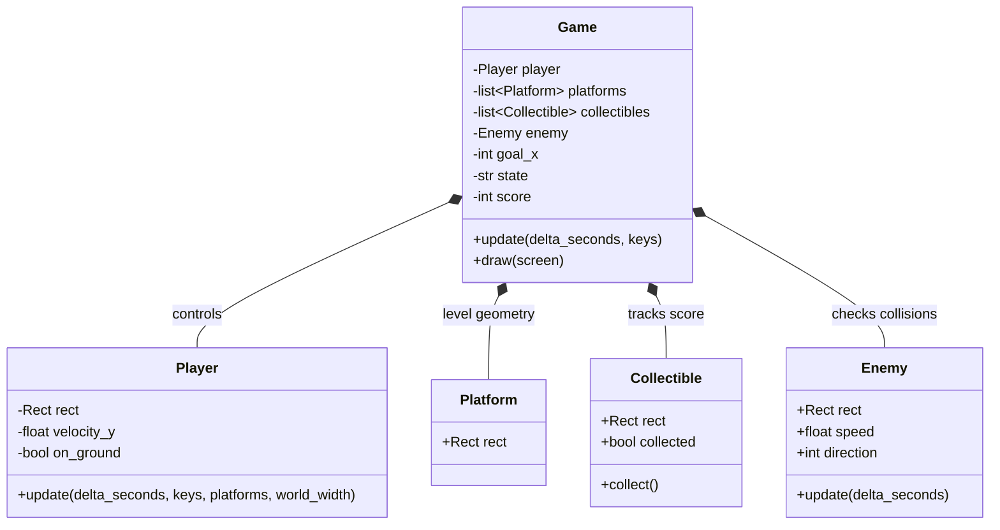
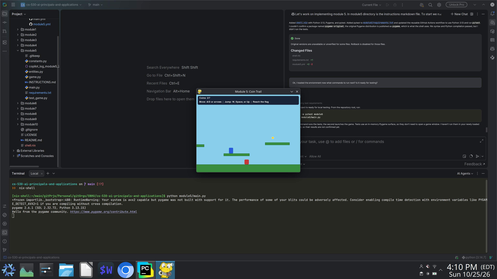
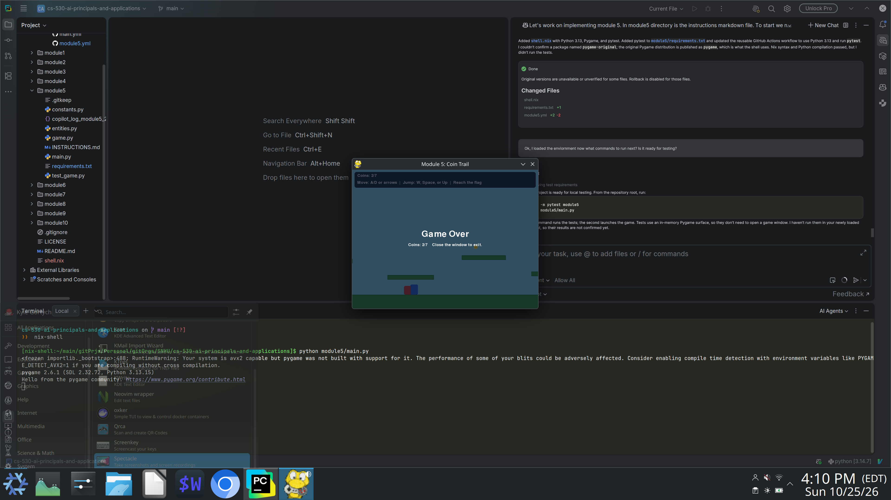
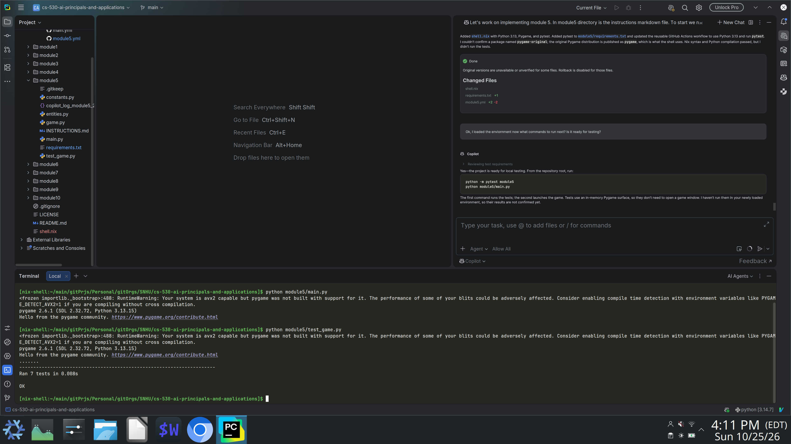
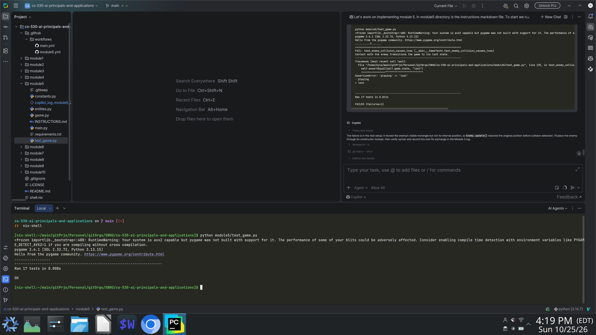
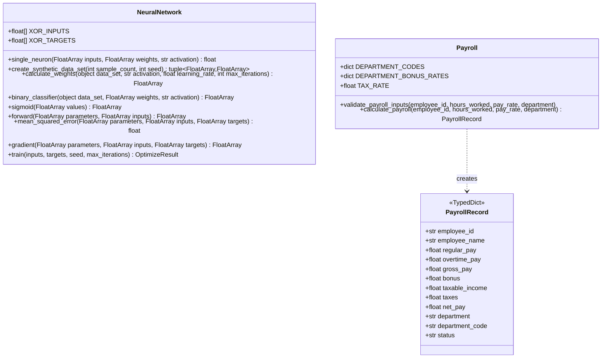

<div align="right">
 


</div>

# cs-530-ai-principals-and-applications
Work from AI Principals and Applications

## About

## Motivation
To show the work done in CS 510 Operating Systems Principles from SNHU.

## Getting Started
Setup is done via `git clone url`.

Then the dependecies to add are .

## Installation

### Tools
Installation best via a system level package manager or ephemeral build environment.
Transitvie dependecies such as language are shown via tree level.

- git
- python 3.14

## Reflection


## Design Overview

Testing is done using main.yml as main entrypoint to run the diffrent project tests.

### Module 5

<details>
<summary>Click to see</summary>

#### UML Class Diagram



#### Source Code

- [Game entry point](module5/main.py)
- [Game state and rendering](module5/game.py)
- [Player, platform, collectible, and enemy entities](module5/entities.py)
- [Game constants](module5/constants.py)
- [Python dependencies](module5/requirements.txt)

Run the game from the repository root:

```bash
python module5/main.py
```

#### Testing

Run the unit tests from the repository root:

```bash
python -m pytest module5
```

The tests in [test_game.py](module5/test_game.py) cover player jumping, platform
landing, world boundaries, entity validation, coin scoring, enemy collision,
falling, win/loss states, and rendering to an in-memory Pygame surface. GitHub
Actions runs this same test command on pushes to `main` and on manual dispatch.

#### Screenshots

<div align="center">
  
  <p>Gameplay</p>
</div>

<div align="center">
  
  <p>Game over screen</p>
</div>

<div align="center">
  
  <p>Initial test run</p>
</div>

<div align="center">
  
  <p>Updated test run</p>
</div>

</details>

### Module 9

<details>
<summary>Click to see Module 9 work</summary>

<details>
<summary>UML Class Diagram</summary>



</details>

<details>
<summary>Source Code</summary>

- [Neural network implementation](module9/neural_network.py)
- [Payroll implementation](module9/payroll.py)
- [Python dependencies](module9/requirements.txt)

Run the neural-network example from the repository root:

```bash
python module9/neural_network.py
```

Run the payroll example from the repository root:

```bash
python module9/payroll.py
```

</details>

<details>
<summary>Testing and CI</summary>

Run the unit and integration tests from the repository root:

```bash
python -m pytest module9/tests
```

The tests cover neural-network sigmoid behavior, backpropagation gradients,
repeatable training, XOR prediction integration, payroll validation, overtime,
bonuses, taxes, rounding, and payroll record invariants. Additional unit and
integration tests run the synthetic single-neuron and binary-classifier
workflows for both supported `sigmoid` and `step` activation functions. The
classification tests calculate one set of weights with the sigmoid gradient
and one set with the perceptron learning rule for the step activation, then
run the binary classifier twice and verify that both prediction paths return
binary values and achieve at least 95 percent accuracy on the synthetic data.
A unit test also verifies that `binary_classifier` calls `single_neuron` once
for every data-set row.

GitHub Actions runs the Module 9 workflow with Python 3.12 and 3.13, checks
PEP 8 style and formatting with Ruff, and executes the tests through
[main.yml](.github/workflows/main.yml).

</details>

</details>
